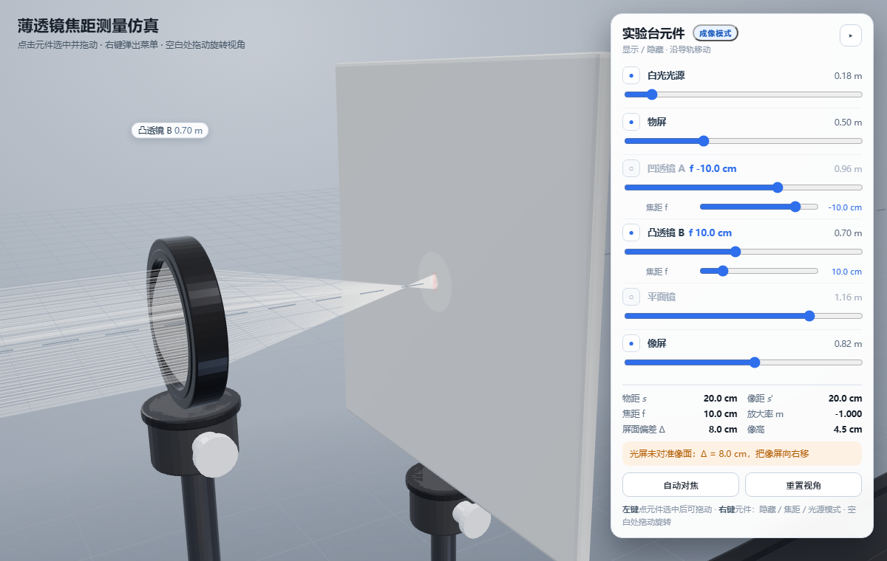
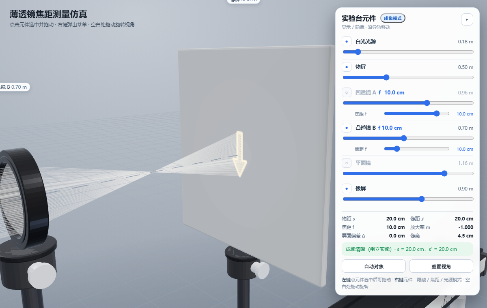

# 薄透镜焦距测量仿真（Thin Lens Focal Length Simulator）

一个**单文件、离线可用**的 WebGL 物理实验仿真：白光光源 / 物屏 / 凸透镜 / 凹透镜 / 平面镜 / 像屏 可以在光具座上自由移动，实时显示光路与屏上成像。

- 单个 HTML 文件，**无外部依赖**（three.js 与模型全部内嵌）
- 双击即可打开，不需要服务器、不需要联网
- 面向中学/大学物理实验教学：物距像距法、自准直法、共轭法、辅助透镜法

## 功能

| 功能 | 说明 |
| --- | --- |
| 元件自由移动 | 左键拖动元件或用右侧滑块，实时重算光路 |
| 右键菜单 | 显示/隐藏、改焦距、光源模式（平行/发散/汇聚）、倾角 |
| 光束倾角 | 上下、左右两个方向；像会随光束平移，光照不到的部分不出现 |
| 屏上成像 | 由**真实光线落点**生成：有光才有像，缺光就缺块，出屏就没有 |
| 自动对焦 | 把像屏移到像面；虚像或平行出射时按钮置灰并说明原因 |
| 五种预设 | 物距像距法 / 自准直法 / 共轭法两步 / 辅助透镜法 |
| 数值面板 | 物距 s、像距 s′、焦距 f、放大率 m、屏面偏差 Δ、像高 |
| 元件避让 | 像屏不会与其它元件重合（自动留 2 cm） |

## 使用

1. 下载 `thin-lens-sim.html`
2. 用 Chrome / Edge 打开（`Ctrl + F5` 可强制刷新）
3. 点右上角「切换模式」选择实验方法，按提示移动元件

**操作**：左键点元件选中后拖动 · 右键元件弹出菜单 · 空白处拖动旋转视角 · 滚轮缩放

## 物理模型

- 薄透镜成像：`1/s′ + 1/s = 1/f`，横向放大率 `m = −s′/s`
- 像屏上图案由光线逐条追迹（含口径遮挡、渐晕）得到
- 平行光倾斜：整束光偏移，照明区滑出物窗时成像随之缺失

## 许可

MIT License，见 `LICENSE`。

## 说明

本项目为教学演示用途，模型为近轴薄透镜近似，未包含像差、衍射与色散。
